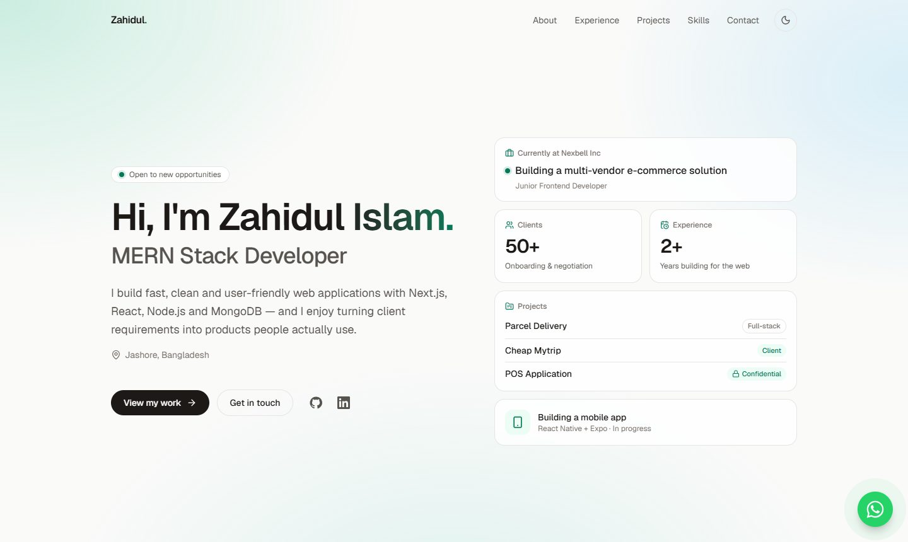
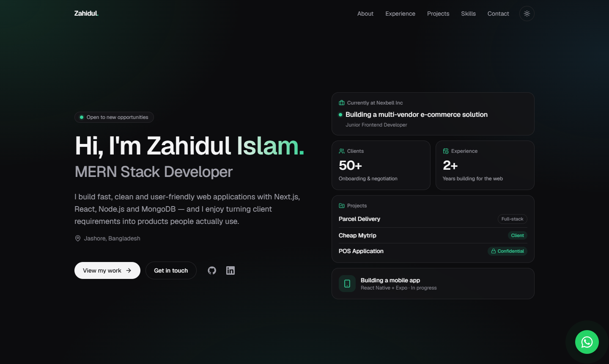
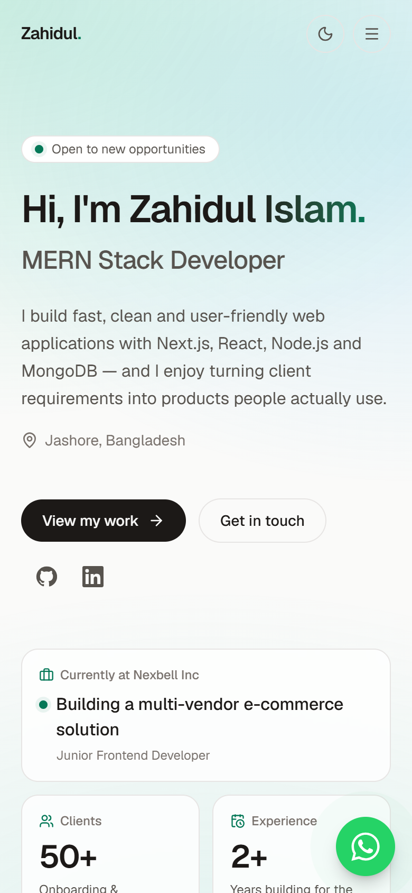

<div align="center">

# Zahidul Islam — Portfolio

**MERN Stack Developer · Jashore, Bangladesh**

A minimal, fast personal portfolio built with Next.js and Tailwind CSS — with light/dark themes,
soft gradient styling and a floating WhatsApp chat widget for instant contact.


</div>

---

## Preview



<table>
  <tr>
    <td width="70%"></td>
    <td width="30%"></td>
  </tr>
  <tr>
    <td align="center"><sub>Dark theme</sub></td>
    <td align="center"><sub>Mobile</sub></td>
  </tr>
</table>

## Features

- **Hero with highlight cards** — current role, 50+ clients, 2+ years, projects and the mobile app in progress, each linking to its section
- **Floating WhatsApp widget** — visitors pick a quick message or write their own, and it opens straight in WhatsApp; they can send as many messages as they like
- **Light / dark theme** — follows the system setting, with a manual toggle
- **Full-screen mobile menu** — animated overlay with scroll lock, Escape-to-close and smooth scroll to sections
- **Soft gradient background** and subtle scroll-reveal animations (respects `prefers-reduced-motion`)
- **Fully responsive**, static-rendered and SEO-ready (title, description, Open Graph)
- **Single content file** — every piece of text lives in one place, so updates need no component changes

## Sections

| Section | What it shows |
| --- | --- |
| Hero | Intro, location, call-to-actions, social links and highlight cards |
| About | Professional summary and key numbers |
| Experience | Junior Frontend Developer at Nexbell Inc — multi-vendor e-commerce solution |
| Client handling | 50+ clients: software onboarding, requirement gathering, negotiation, support |
| Projects | Parcel Delivery · Cheap Mytrip (client) · POS Application (client, confidential) |
| Currently building | Cross-platform mobile app with React Native + Expo |
| Skills | Frontend, backend, database, mobile, tools |
| Education | BBA in Accounting, National University · Languages |
| Contact | Email, phone, WhatsApp |

## Tech stack

| | |
| --- | --- |
| Framework | [Next.js 15](https://nextjs.org/) (App Router) + React 19 |
| Language | TypeScript |
| Styling | [Tailwind CSS 4](https://tailwindcss.com/) with CSS-variable design tokens |
| Theming | [next-themes](https://github.com/pacocoursey/next-themes) |
| Animation | [Framer Motion](https://www.framer.com/motion/) |
| Icons | [Lucide](https://lucide.dev/) + inline SVG brand icons |
| Fonts | Geist via `next/font` |

## Getting started

Requires **Node.js 18.18+** (Node 20+ recommended).

```bash
npm install
npm run dev        # http://localhost:3000
```

| Script | Description |
| --- | --- |
| `npm run dev` | Start the development server |
| `npm run build` | Create a production build |
| `npm run start` | Serve the production build |
| `npm run lint` | Run ESLint |

> **Note:** `next dev` and `next build` share the `.next` folder. Stop the dev server before running a build —
> otherwise the dev server breaks with 404s / `[object Event]` errors. If that happens, delete `.next` and restart `npm run dev`.

## Editing content

All content lives in **[`src/data/profile.ts`](src/data/profile.ts)** — name, intro, stats, experience,
client work, projects, skills, education and nav links.

- **Links:** replace the `"#"` placeholders for GitHub, LinkedIn and the project Client / Server / Live links.
- **WhatsApp number:** `profile.whatsapp` — international format without `+` (e.g. `8801915215719`).
- **Projects:** each project has a `type` — `personal`, `client` or `confidential`. Confidential projects show a lock badge and a note instead of links.
- **Colors / gradient:** design tokens are in [`src/app/globals.css`](src/app/globals.css). Adjust `--glow-1/2/3` to make the background gradient lighter or stronger.

## Project structure

```
src/
├── app/
│   ├── globals.css        # Design tokens (light/dark), gradient background
│   ├── layout.tsx         # Fonts, metadata, theme provider
│   └── page.tsx           # Section order
├── components/
│   ├── Hero.tsx           # Intro + HeroHighlights cards
│   ├── HeroHighlights.tsx
│   ├── Navbar.tsx         # Desktop links + full-screen mobile menu
│   ├── WhatsAppWidget.tsx # Floating chat button and message panel
│   ├── About.tsx · Experience.tsx · ClientHandling.tsx · Projects.tsx
│   ├── NowBuilding.tsx · Skills.tsx · Education.tsx · Contact.tsx · Footer.tsx
│   └── Section.tsx        # Section heading, Reveal animation, Tag
├── data/
│   └── profile.ts         # All portfolio content
└── lib/
    └── whatsapp.ts        # wa.me link builder + open-widget event
```

## Deployment

The site is fully static, so it can be hosted anywhere. The easiest option is **[Vercel](https://vercel.com/new)**:
push the repository to GitHub, import it on Vercel and deploy — no configuration needed.

## Contact

**Zahidul Islam** — [zahidulislam.here@gmail.com](mailto:zahidulislam.here@gmail.com) · [WhatsApp](https://wa.me/8801915215719)
